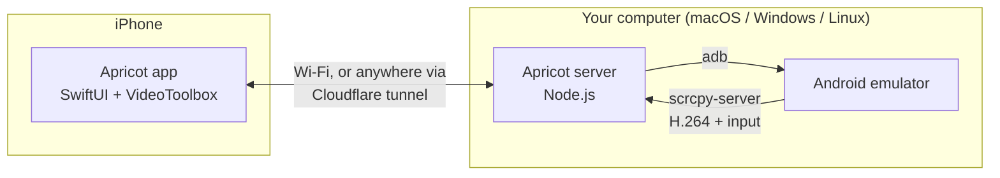

<div align="center">


# Apricot

**Run your Android APKs on your iPhone.**
Self-hosted on macOS, Windows or Linux. Open source, no App Store, no cloud.

[](LICENSE)


[](.github/workflows/ci.yml)

<!-- Record a 10-second GIF of: share APK → it launches → tap around. Save as assets/demo.gif and uncomment:

-->

</div>

---

Apricot puts your Android apps on your iPhone's home screen. Tap one and it opens full screen, like a native app:
swipe up to close it, swipe in from the left edge to go back.

Behind the scenes your computer (macOS, Windows or Linux) runs Android in the background, with no window,
starting it when you open an app and shutting it down when you're done. The iPhone streams the app at up to 60 fps with hardware
H.264 decoding and sends your touches and keyboard back. Pair once by scanning a QR code; after that it works from anywhere,
on any Wi-Fi or on cellular.

Share an `.apk` to Apricot from Files, Safari, Slack or AirDrop. It uploads, installs and opens in one tap.



## Features

| | |
|---|---|
| 🏠 **Apps as apps** | An iOS-style home screen with each APK's real icon and name. Long-press for force stop, clear data, uninstall |
| 📱 **Native feel** | Apps open full screen with a zoom animation. Swipe up to close, edge-swipe to go back, multi-touch, the iOS keyboard types into Android |
| 🪄 **Invisible Android** | No emulator window. Android starts when you open an app, resumes from a snapshot, and stops after 10 idle minutes |
| 📷 **QR pairing** | Run `./apricot`, scan the code. No IP addresses, no ports, no accounts |
| 🌍 **Works anywhere** | A free, encrypted Cloudflare tunnel (no account) lets the iPhone connect over cellular or any Wi-Fi |
| ⚡ **Fast** | scrcpy's H.264 stream, decoded in hardware on the iPhone, with no transcoding. On your home Wi-Fi it connects directly |
| 📤 **Share to install** | "Open in Apricot" from any app, or drag and drop onto the web dashboard |
| 🪵 **Live logcat** | Filter by app and level, search, pause. Under Settings → Logs |
| 🔒 **Self-hosted** | Your computer, your apps. Every request needs the token that only the QR code carries |

## Quick start

You need an iPhone on iOS 17+ and a computer with [Node.js 20+](https://nodejs.org):

| Host | Works with | Needs |
|---|---|---|
| **macOS** | Apple Silicon or Intel | Nothing extra (Hypervisor.framework is built in) |
| **Windows** 10/11 | x64 | *Windows Hypervisor Platform* turned on, virtualization enabled in BIOS |
| **Linux** | x86_64 | KVM (`/dev/kvm`) |

On ARM Windows or ARM Linux, Google's emulator doesn't run, but Apricot works with a real Android phone over USB.

**1. Start Apricot on your computer**

```bash
git clone https://github.com/jabbab-cs/apricot.git
cd apricot && ./apricot
```

On Windows, double-click **`apricot.cmd`** (or run it from a terminal).

The first run sets everything up (adb, the Android emulator and a slim virtual phone, about 2 GB, roughly 10 minutes).
After that it starts in seconds and prints a QR code. Details are in [docs/SETUP.md](docs/SETUP.md).

**2. Install the iPhone app**

- **On a Mac:** open `ios/Apricot.xcodeproj` in Xcode, choose your team under *Signing & Capabilities*,
  plug in your iPhone and press **Run**. A free Apple ID works.
- **On Windows or Linux:** download `Apricot-unsigned.ipa` from [Releases](../../releases) and install it with
  [Sideloadly](https://sideloadly.io) or [AltStore](https://altstore.io) (Windows), or
  [Sideloader](https://github.com/Dadoum/Sideloader) (Linux). They sign it with your own Apple ID.

Step-by-step guides: [docs/SIDELOADING.md](docs/SIDELOADING.md).

**3. Scan the QR code** with the Apricot app (or the iPhone Camera). Done: share an APK to Apricot and it appears on the home screen.

Lost the QR code? Open **http://localhost:7420** on the computer and click **Pair iPhone**.

No APK handy? Try [`examples/hello-apricot/hello-apricot.apk`](examples/hello-apricot): a 30 KB test app with a
tap counter, a text field and logcat output, built without Gradle by its own [`build.sh`](examples/hello-apricot/build.sh).

## Using it

| On the iPhone | Does |
|---|---|
| Tap an icon | Opens the app full screen (installs it first if needed) |
| Long-press an icon | Force stop, clear data, uninstall |
| Swipe up from the bottom | Closes the app, back to the home screen |
| Swipe in from the left edge | Android Back |
| ⌨️ button | iOS keyboard → types into the focused Android field |
| **Android** in the dock | The whole Android screen: launcher, settings, notifications |
| **Add APK** in the dock | Pick an APK from Files |
| **Settings** in the dock | Devices, logs, connection, unpair |

The web dashboard at **http://localhost:7420** has the same features with mouse and keyboard.
Right-click is Back, the scroll wheel scrolls, and you type straight into the screen.

## Configuration

Set environment variables before `./apricot`:

| Variable | Default | |
|---|---|---|
| `APRICOT_PORT` | `7420` | HTTP / WebSocket port |
| `APRICOT_TOKEN` | *(random)* | The pairing token. Generated on first run and kept in `server/data/token`. Delete that file to unpair every phone |
| `APRICOT_REMOTE` | `1` | `0` turns off the Cloudflare tunnel, so the iPhone only connects on the same Wi-Fi |
| `APRICOT_IDLE_MINUTES` | `10` | Shut down the emulator Apricot started after this many minutes without viewers. `0` keeps it running |
| `APRICOT_MAX_SIZE` | `1600` | Max video dimension in pixels |
| `APRICOT_BIT_RATE` | `8000000` | Video bit rate |
| `APRICOT_MAX_FPS` | `60` | Frame rate cap |
| `APRICOT_HEADLESS` | `1` | `0` shows the emulator window |
| `APRICOT_EMULATOR_GPU` | `host` | `-gpu` mode for emulators Apricot boots. Keep `host` for a smooth stream. Use `swiftshader_indirect` on machines without a GPU |
| `APRICOT_DEBUG` | `0` | `1` logs per-viewer frame stats, touches and control messages |
| `ANDROID_HOME` | macOS `~/Library/Android/sdk`<br>Windows `%LOCALAPPDATA%\Android\Sdk`<br>Linux `~/Android/Sdk` | Android SDK location (Android Studio's default) |

On Windows, set variables in PowerShell like this: `$env:APRICOT_IDLE_MINUTES="30"; .\apricot.cmd`.

### Away from home

Nothing to do. The QR code contains both your computer's local address and a `https://….trycloudflare.com`
address from a free [Cloudflare quick tunnel](https://developers.cloudflare.com/cloudflare-one/connections/connect-networks/do-more-with-tunnels/trycloudflare/)
that Apricot starts for you (it downloads `cloudflared` on first use). The iPhone uses the local address at home
and switches to the tunnel elsewhere. The tunnel address changes when the server restarts; the app reconnects
on its own as long as one of the addresses still works, otherwise scan the new code.

Traffic through the tunnel is HTTPS, and every request must carry your token. If you'd rather not use Cloudflare, set
`APRICOT_REMOTE=0` and use a VPN such as Tailscale instead.

## How it works

- **Server** (`server/`): a small Node.js app that runs anywhere Node does. It parses APKs itself (binary manifest and
  `resources.arsc`) to get names, versions and icons (drawing adaptive/vector icons into PNGs), boots and stops the
  emulator on demand, drives `adb` to install and manage apps, and runs
  [scrcpy-server](https://github.com/Genymobile/scrcpy) on the device to capture the screen and inject input.
- **iPhone app** (`ios/`): SwiftUI. Frames arrive over a WebSocket as Annex-B H.264 and are decoded in
  hardware with VideoToolbox, off the main thread, then shown on an `AVSampleBufferDisplayLayer`.
- **Dashboard** (`server/public/`): plain HTML/JS using WebCodecs. No build step.

Full protocol and API: [docs/ARCHITECTURE.md](docs/ARCHITECTURE.md).

## Project layout

```
apricot/
├── server/            Node.js host server + web dashboard
│   ├── src/           adb, APK parser, scrcpy driver, HTTP/WebSocket API
│   ├── public/        web dashboard (no build step)
│   └── test/          node:test unit tests
├── ios/               SwiftUI iPhone app (XcodeGen project.yml + generated .xcodeproj)
├── examples/          hello-apricot test app (raw build tools, no Gradle)
├── apricot            start here (macOS/Linux); apricot.cmd on Windows
├── scripts/           setup.sh (macOS/Linux), setup-windows.ps1, e2e-smoke.mjs
├── docs/              setup, sideloading, architecture, troubleshooting
└── assets/            logo
```

## Limitations

- **Apps that need Google Play Services** (Maps SDK, Firebase Auth via Google, in-app billing) won't fully
  work on the default `google_apis` image. Use a *Google Play* system image in Android Studio for those.
- **No audio yet.** It's on the roadmap.
- **ARM-only native libraries**: Apple Silicon runs `arm64-v8a` images natively. The x86_64 images used on
  Windows and Linux PCs include Google's ARM translation (Android 11+), which covers most apps.
- **Building the iPhone app needs a Mac** (Xcode is macOS-only). Windows and Linux users sideload the prebuilt IPA.
- **It's still an emulator.** Apps can't run on iOS itself, so Android runs on your computer, hidden. The computer needs to be on.
- **Over the tunnel**, latency depends on your connection and Cloudflare's nearest edge. Expect it to feel a little less snappy than at home.

## Roadmap

- [ ] Audio streaming
- [ ] Clipboard sync (iOS ↔ Android)
- [ ] Physical Android devices over USB/Wi-Fi in the device picker *(adb already sees them)*
- [ ] Redroid backend (Android in a container, lighter than an emulator) for Linux hosts
- [ ] GitHub Action: "Try this PR on your phone" link
- [ ] Screen recording

## Contributing

PRs are welcome. Start with [CONTRIBUTING.md](CONTRIBUTING.md). For bugs, please include your server
log and the output of `curl localhost:7420/api/status`.

## Acknowledgements

Screen capture and input injection use [scrcpy](https://github.com/Genymobile/scrcpy) by Genymobile
(Apache-2.0). It's downloaded during setup and not redistributed in this repository.

## License

[MIT](LICENSE). Apricot is not affiliated with Google or Apple. Android is a trademark of Google LLC.
Only run apps you have the right to run.
