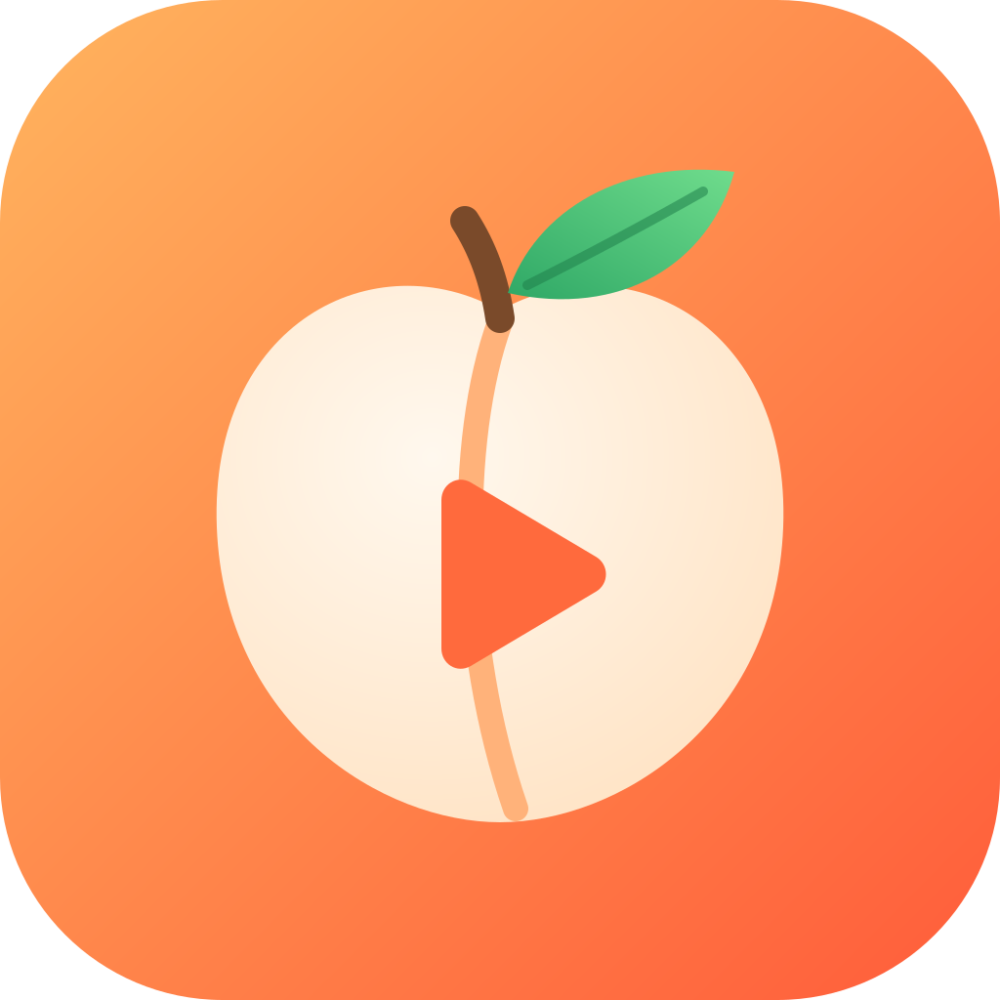
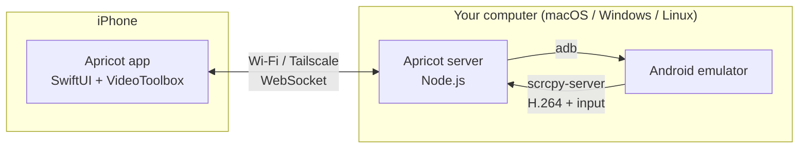

<div align="center">



# Apricot

**Run your Android APKs on your iPhone.**
Self-hosted on macOS, Windows or Linux. Open source, no App Store, no cloud.

[](LICENSE)


[](.github/workflows/ci.yml)

<!-- Record a 10-second GIF of: share APK → it launches → tap around. Save as assets/demo.gif and uncomment:

-->

</div>

---

Apricot turns your iPhone into an Android phone for testing your own apps. Your computer (macOS, Windows
or Linux) runs a real Android emulator. The iPhone app streams its screen at up to 60 fps with hardware H.264 decoding, and sends
your touches, gestures and keyboard back to it. Using it feels like holding an Android phone.

Share an `.apk` to Apricot from Files, Safari, Slack or AirDrop. It uploads, installs and launches in one tap.



## Features

| | |
|---|---|
| 📱 **Feels like a phone** | Full-screen live screen, multi-touch, Android back/home/recents bar, swipe gestures, the iOS keyboard types into Android |
| ⚡ **Fast** | scrcpy's H.264 stream, decoded in hardware on the iPhone, with no transcoding |
| 📦 **APK manager** | Library with icons, versions and ABIs read straight from the APK. Install, run, stop, clear data, uninstall |
| 📤 **Share to install** | "Open in Apricot" from any app, or drag and drop onto the web dashboard |
| 🪵 **Live logcat** | Filter by app and level, search, pause. Right on your phone |
| 🔍 **Zero config** | The iPhone finds your computer over Bonjour/mDNS. Boot virtual phones from the app |
| 🖥️ **Web dashboard** | The same controls in any browser on your computer |
| 🔒 **Self-hosted** | Nothing leaves your network. Optional token auth. Works anywhere over Tailscale |

## Quick start

You need an iPhone on iOS 17+ and a computer with [Node.js 20+](https://nodejs.org):

| Host | Works with | Needs |
|---|---|---|
| **macOS** | Apple Silicon or Intel | Nothing extra (Hypervisor.framework is built in) |
| **Windows** 10/11 | x64 | *Windows Hypervisor Platform* turned on, virtualization enabled in BIOS |
| **Linux** | x86_64 | KVM (`/dev/kvm`) |

On ARM Windows or ARM Linux, Google's emulator doesn't run, but Apricot works with a real Android phone over USB.

**1. Set up your computer** (one time, about 10 minutes, mostly the Android download)

```bash
git clone https://github.com/jabbab-cs/apricot.git
```

macOS or Linux:

```bash
cd apricot && ./scripts/setup.sh
```

Windows (PowerShell):

```powershell
cd apricot; powershell -ExecutionPolicy Bypass -File scripts\setup-windows.ps1
```

The script installs adb and the Android emulator (or reuses Android Studio's), creates a virtual phone,
and downloads `scrcpy-server`. Details are in [docs/SETUP.md](docs/SETUP.md).

**2. Start the server**

```bash
cd server && npm start
```

**3. Install the iPhone app**

- **On a Mac:** open `ios/Apricot.xcodeproj` in Xcode, choose your team under *Signing & Capabilities*,
  plug in your iPhone and press **Run**. A free Apple ID works.
- **On Windows or Linux:** download `Apricot-unsigned.ipa` from [Releases](../../releases) and install it with
  [Sideloadly](https://sideloadly.io) or [AltStore](https://altstore.io) (Windows), or
  [Sideloader](https://github.com/Dadoum/Sideloader) (Linux). They sign it with your own Apple ID.

Step-by-step guides: [docs/SIDELOADING.md](docs/SIDELOADING.md).

**4. Play.** Open Apricot on your iPhone, tap your computer, boot the virtual phone, and share an APK to the app.

No APK handy? Try [`examples/hello-apricot/hello-apricot.apk`](examples/hello-apricot): a 30 KB test app with a
tap counter, a text field and logcat output, built without Gradle by its own [`build.sh`](examples/hello-apricot/build.sh).

## Using it

| On the iPhone | Does |
|---|---|
| Tap, drag, pinch | Touch input, up to 10 fingers |
| ◀ ● ■ bar | Android Back, Home, Recents |
| ⌨️ button | iOS keyboard → types into the focused Android field |
| ⋯ menu | Rotate, notifications, quick settings, volume, power, screenshot, full screen |
| **Apps** tab | Library and installed apps. Tap **Run**, swipe for more |
| **Logs** tab | Live logcat for one app or everything |
| **Device** tab | Switch devices, boot emulators, server info |

The web dashboard at **http://localhost:7420** has the same features with mouse and keyboard.
Right-click is Back, the scroll wheel scrolls, and you type straight into the screen.

## Configuration

Set environment variables before `npm start`:

| Variable | Default | |
|---|---|---|
| `APRICOT_PORT` | `7420` | HTTP / WebSocket port |
| `APRICOT_TOKEN` | *(none)* | Require this token from every client. Recommended outside your home network |
| `APRICOT_MAX_SIZE` | `1600` | Max video dimension in pixels |
| `APRICOT_BIT_RATE` | `8000000` | Video bit rate |
| `APRICOT_MAX_FPS` | `60` | Frame rate cap |
| `APRICOT_HEADLESS` | `0` | `1` boots emulators without a window (servers, CI) |
| `APRICOT_EMULATOR_GPU` | `host` | `-gpu` mode for emulators Apricot boots. Keep `host` for a smooth stream. Use `swiftshader_indirect` on machines without a GPU |
| `APRICOT_DEBUG` | `0` | `1` logs per-viewer frame stats, touches and control messages |
| `APRICOT_BONJOUR` | `1` | `0` disables auto-discovery |
| `ANDROID_HOME` | macOS `~/Library/Android/sdk`<br>Windows `%LOCALAPPDATA%\Android\Sdk`<br>Linux `~/Android/Sdk` | Android SDK location (Android Studio's default) |

On Windows, set variables in PowerShell like this: `$env:APRICOT_TOKEN="secret"; npm start`.

### Away from home

Install [Tailscale](https://tailscale.com) on the computer and the iPhone, then choose
*Enter address manually* and use the computer's Tailscale IP (`100.x.y.z`). Set `APRICOT_TOKEN` too.

## How it works

- **Server** (`server/`): a small Node.js app that runs anywhere Node does. It parses APKs itself (binary manifest and
  `resources.arsc`) to get names, versions and icons, drives `adb` to install and manage apps, and runs
  [scrcpy-server](https://github.com/Genymobile/scrcpy) on the device to capture the screen and inject input.
- **iPhone app** (`ios/`): SwiftUI. Frames arrive over a WebSocket as Annex-B H.264 and are decoded in
  hardware with VideoToolbox, off the main thread, then shown on an `AVSampleBufferDisplayLayer`.
- **Dashboard** (`server/public/`): plain HTML/JS using WebCodecs. No build step.

Full protocol and API: [docs/ARCHITECTURE.md](docs/ARCHITECTURE.md).

## Project layout

```
apricot/
├── server/            Node.js host server + web dashboard
│   ├── src/           adb, APK parser, scrcpy driver, HTTP/WebSocket API
│   ├── public/        web dashboard (no build step)
│   └── test/          node:test unit tests
├── ios/               SwiftUI iPhone app (XcodeGen project.yml + generated .xcodeproj)
├── examples/          hello-apricot test app (raw build tools, no Gradle)
├── scripts/           setup.sh (macOS/Linux), setup-windows.ps1, e2e-smoke.mjs
├── docs/              setup, sideloading, architecture, troubleshooting
└── assets/            logo
```

## Limitations

- **Apps that need Google Play Services** (Maps SDK, Firebase Auth via Google, in-app billing) won't fully
  work on the default `google_apis` image. Use a *Google Play* system image in Android Studio for those.
- **No audio yet.** It's on the roadmap.
- **ARM-only native libraries**: Apple Silicon runs `arm64-v8a` images natively. The x86_64 images used on
  Windows and Linux PCs include Google's ARM translation (Android 11+), which covers most apps.
- **Building the iPhone app needs a Mac** (Xcode is macOS-only). Windows and Linux users sideload the prebuilt IPA.
- It's a streaming client, so the computer needs to be on.

## Roadmap

- [ ] Audio streaming
- [ ] Clipboard sync (iOS ↔ Android)
- [ ] Physical Android devices over USB/Wi-Fi in the device picker *(adb already sees them)*
- [ ] Redroid backend (Android in a container) for headless Linux servers
- [ ] GitHub Action: "Try this PR on your phone" link
- [ ] Screen recording

## Contributing

PRs are welcome. Start with [CONTRIBUTING.md](CONTRIBUTING.md). For bugs, please include your server
log and the output of `curl localhost:7420/api/status`.

## Acknowledgements

Screen capture and input injection use [scrcpy](https://github.com/Genymobile/scrcpy) by Genymobile
(Apache-2.0). It's downloaded during setup and not redistributed in this repository.

## License

[MIT](LICENSE). Apricot is not affiliated with Google or Apple. Android is a trademark of Google LLC.
Only run apps you have the right to run.
